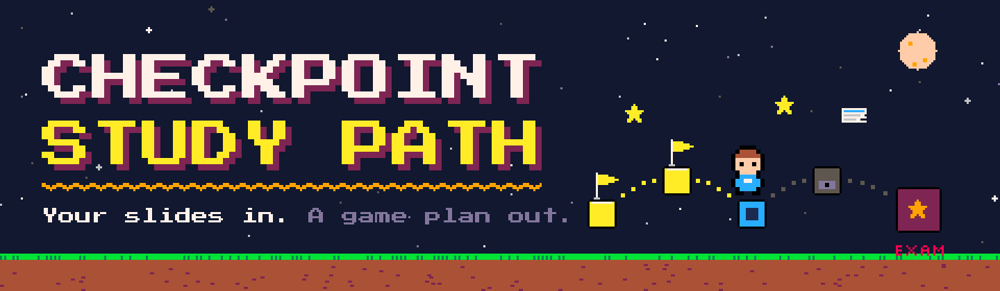
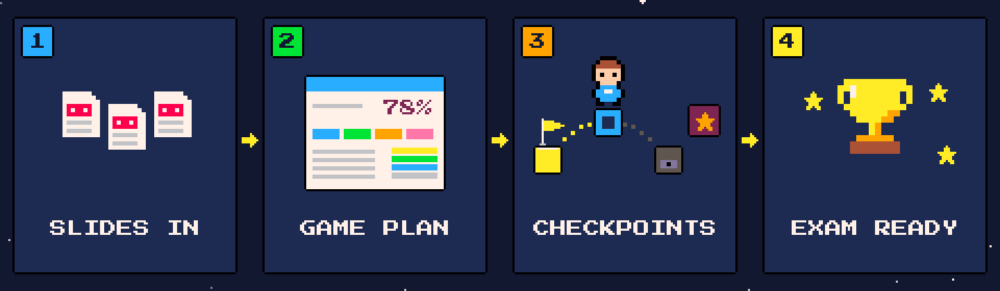
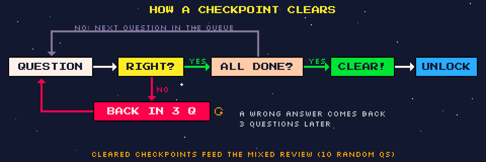
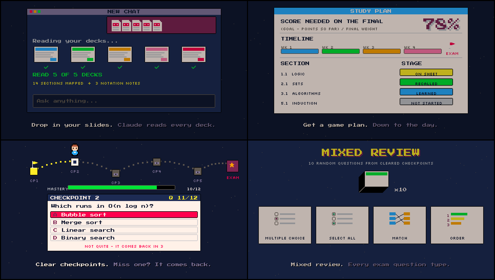

<div align="center">



<h1>
  
  Checkpoint Study Path
  
</h1>

**Your slides in. A game plan out.** 🎮📚

An exam-prep skill for [Claude](https://claude.ai). Give it your lecture slides and it builds you<br>
a study plan, a level-by-level quiz path you clear one checkpoint at a time, and an optional cheat sheet.

<br>


<a href="https://github.com/nicklukekurian-web/checkpoint-study-path/stargazers"></a>

[🕹️ Install](#%EF%B8%8F-install) · [🗺️ How it works](#%EF%B8%8F-how-it-works) · [🏁 The Checkpoint Path](#-the-checkpoint-path) · [🎒 What you get](#-what-you-get) · [💬 Prompts](#-example-prompts) · [❓ FAQ](#-faq)

</div>


## 🕹️ Install

> **You need:** a Claude **Pro, Max, Team or Enterprise** plan, with **Code execution and file creation** turned on in **Settings → Capabilities**.

1. ⬇️ **Download** [`checkpoint-study-path.zip`](https://github.com/nicklukekurian-web/checkpoint-study-path/raw/main/dist/checkpoint-study-path.zip). Don't unzip it.
2. ⚙️ In Claude, open **Settings → Capabilities**, scroll to **Skills**, click **Upload skill** and pick the zip.
3. ✅ Make sure the skill's toggle is **on**.
4. 🚀 Start a new chat, attach your slides and say:

```text
Use the checkpoint-study-path skill for my Discrete Math final on Dec 12.
```

<!-- VIDEO: on github.com, edit this file, delete the demo.gif line below, and drag assets/checkpoint-study-path.mp4 into this spot to get the video player with sound. -->
<div align="center">

</div>

Re-reading slides *feels* like studying, but nothing sticks, and a week before the exam you still can't tell what you actually know. This skill turns the slides you already have into a game you play every day until the test.

- 📥 **It starts from *your* slides.** Claude reads every deck first, so the notation, examples and scope match what your professor actually teaches, not some random textbook.
- 🧮 **You get a real plan.** It works out the score you need on the final for the grade you want, then lays out every day until the exam.
- 🏁 **You clear checkpoints, not chapters.** One checkpoint per lecture deck. It only clears when you've answered *every* question right at least once.
- 🔁 **Missed questions come back.** Get one wrong and it returns three questions later, so you can't skip past what you don't know.
- 🧪 **Claude checks its own work.** Answer keys are verified by script, video links are checked, and the quiz app is tested end to end before you ever see it.


## 🗺️ How it works



| 🎮 | Step | What happens |
|:-:|---|---|
|  | **1. Slides in** | Claude asks once for your exam date, format, question types, grade weights and materials. Then it reads every deck and maps which sections each one covers, flags where your professor differs from the textbook, and lists topics the slides skip (so they stay out of your quizzes). |
|  | **2. Game plan** | A study plan doc: the score you need (formula + scenario table, computed by script), a weekly routine, a week-by-week timeline and a coverage tracker. |
|  | **3. Checkpoints** | A quiz app published as a Claude artifact: one checkpoint per deck, in course order, each with short videos, a mini-lesson in your professor's notation, then 10–17 questions. |
|  | **4. Exam ready** | Mixed review keeps old checkpoints fresh, and an optional one-page cheat sheet follows a space budget per chapter. |


## 🏁 The Checkpoint Path



<table>
<tr>
<td width="50%" valign="top">

### 🔓 Mastery gating
- A checkpoint clears only when **every** question has been answered correctly once.
- A wrong answer is **requeued 3 questions later**.
- Clearing a checkpoint **unlocks the next one** on the track.
- Catch-up material and new material can run as **separate tracks**.

</td>
<td width="50%" valign="top">

### 🎲 Mixed review
- **10 random questions** pulled from every checkpoint you've cleared.
- **Progress bars** for each checkpoint and the whole path.
- Progress is **saved in your browser**, so you can come back tomorrow.
- Optional **proof-writing practice** with a model answer and AI feedback.

</td>
</tr>
</table>

**Question types that match your real exam:**

| 🔘 Multiple choice | ☑️ Select all | 🔗 Match | 🔢 Order |
|:-:|:-:|:-:|:-:|
| one right answer | every correct option | pair left with right, plus distractors | put the steps in sequence |

Every answer comes with an explanation, **plus a note on why the tempting wrong option is wrong**. Questions taken straight from your slides are tagged with the deck they came from.


## 🎒 What you get

| 🎒 | Output | Inside |
|:-:|---|---|
|  | **Study plan doc** | Score-needed formula and scenarios · weekly routine · timeline widget · coverage tracker with a stage dropdown (*Not started → Learned → Recalled once → Recalled again → On sheet*) · cheat-sheet space budget · open questions for the review session |
|  | **Checkpoint Path app** | Mastery-gated checkpoints · videos + mini-lessons · exam-style questions · mixed review · saved progress |
|  | **Cheat sheet** *(optional)* | One page, fixed type size, built from the plan's per-chapter space budget |
|  | **Extras** *(optional)* | Master study guide PDF · narrated video crash course with captions and chapters |

<details>
<summary>📸 <b>Peek at the storyboard</b> (8-bit illustrations from the demo video)</summary>
<br>

</details>


## 🛡️ Built-in checks

The skill tells Claude to **never skip** these:

| ✔️ | Check |
|:-:|---|
|  | Every number, answer key and worked example is checked **with a script**, and anything that fails is fixed before it ships. |
|  | Every video link is checked against **YouTube's oEmbed endpoint**, and its exact title and channel are used. No invented links. |
|  | The app is tested **end to end in a headless browser**: every question answered through the UI, every checkpoint cleared, mixed review run, no sideways scrolling at phone width. |
|  | When you upload new slides, the plan and checkpoints are **realigned** and Claude tells you what changed. |


## 💬 Example prompts

```text
Use the checkpoint-study-path skill for my Discrete Math final on Dec 12. Slides attached.
```
```text
The exam is 40 multiple choice + 2 proofs and I get a one-page cheat sheet. Build the path.
```
```text
I just uploaded Deck 7. Realign my plan and checkpoints.
```
```text
Make me the cheat sheet now.
```

> 💡 **Tip:** Answer each question *before* you read the explanation. Mastery gating only works if you actually try.


## ❓ FAQ

<details>
<summary><b>Does it work for any class?</b></summary>
<br>
It's built around lecture slides, so any course with slides or notes works. It shines when questions have clear right answers (math, CS, the sciences).
</details>

<details>
<summary><b>Is it free?</b></summary>
<br>
The skill is free and MIT-licensed. Skills in Claude need a Pro, Max, Team or Enterprise plan.
</details>

<details>
<summary><b>Where does my stuff end up?</b></summary>
<br>
The plan doc and the quiz app are artifacts in <i>your</i> Claude account. They stay private until you choose to share them.
</details>

<details>
<summary><b>Claude didn't use the skill. What now?</b></summary>
<br>
Check that the toggle is on under <b>Settings → Capabilities → Skills</b>, then name it in your message: <i>"Use the checkpoint-study-path skill for…"</i>
</details>

<details>
<summary><b>On a Team or Enterprise plan?</b></summary>
<br>
On Enterprise, an owner has to turn on code execution and Skills in admin settings first. Skills you upload are private to your own account.
</details>


## 🤝 Use it responsibly

- 📄 **Use your own materials.** Don't publish a generated checkpoint that copies your professor's slides or examples unless your school's policy and your professor allow it.
- 🔍 **Spot-check before the exam.** The skill verifies its answer keys, but compare against your slides and textbook too.
- 🧠 **It's a study aid, not a shortcut.** The point is that *you* can answer every question.

## 📁 Repo layout

```
checkpoint-study-path/
├── README.md
├── LICENSE
├── dist/
│   └── checkpoint-study-path.zip     ← upload this to Claude
├── skills/
│   └── checkpoint-study-path/
│       └── SKILL.md                  ← the skill itself
├── assets/                           ← banner, diagrams, icons, demo video
└── tools/
    └── pixel-video/                  ← Python that draws the art + video
```

🎨 Every image and the demo video are drawn in code: Python + Pillow for the pixels, numpy for the chiptune. See [`tools/pixel-video`](tools/pixel-video).

## 🌟 Contributing

Ideas welcome: new question types, other subjects, better pacing rules. Open an issue or a PR. If the skill helped you clear a checkpoint, a ⭐ helps other students find it.

## 📜 License & credits

MIT. See [LICENSE](LICENSE).<br>
Fonts: [Press Start 2P](https://fonts.google.com/specimen/Press+Start+2P) by CodeMan38 and [Silkscreen](https://fonts.google.com/specimen/Silkscreen) by Jason Kottke, both under the SIL Open Font License. Palette inspired by the PICO-8 fantasy console.

<div align="center">
<br>
 &nbsp; Built by <a href="https://github.com/nicklukekurian-web">@nicklukekurian-web</a> &nbsp; 
<br><br>

</div>
